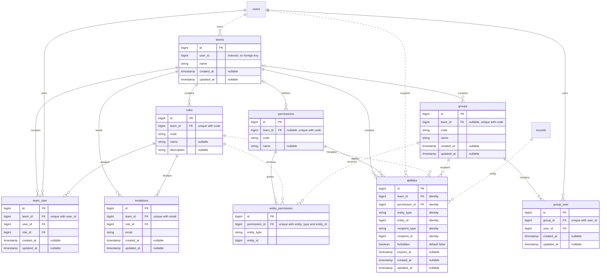

# Database Schema

## Tables

The package creates the following tables. See the [migration files](https://github.com/jurager/teams/tree/main/database/migrations) for their full definitions.

| Table               | Contents                                    |
|---------------------|---------------------------------------------|
| `teams`             | Teams and their owners                      |
| `team_user`         | Team members and their roles                |
| `invitations`       | Pending invitations                         |
| `roles`             | Team roles                                  |
| `permissions`       | Permission codes of teams and global groups |
| `abilities`         | Record rules, one row per recipient         |
| `groups`            | Team groups and global groups               |
| `group_user`        | Group members                               |
| `entity_permission` | Permissions of roles and groups             |

## Record Rules

An `abilities` row contains the team key, `permission_id`, the target record (`entity_type`, `entity_id`), the recipient (`recipient_type`, `recipient_id`), `forbidden`, and nullable `expires_at`, plus timestamps. The team key defaults to `team_id` and can be configured.

The six identity columns are unique together. Changing the decision or deadline updates that row. `forget` deletes it. There are no shared ability definitions or assignment pivots.

`Ability::entity()` and `Ability::recipient()` are polymorphic relationships. The recipient is a user, role, or group. Both use Laravel's morph map when configured. `team()` and `permission()` are ordinary `BelongsTo` relationships; a team's deletion or a permission's deletion cascades to its rules.

User, role, and group `abilities()` relationships are `MorphMany`. Role and group permissions still use `entity_permission` for team-wide grants.

## Relationships

Solid lines are foreign keys. Dotted lines are polymorphic or application relationships; `records` represents your application models. `users` is supplied by the application. Column names below use the default team key.

## Deleting Records

Some records can't be deleted while other records depend on them:

| Deleted       | Result                                                                 |
|---------------|------------------------------------------------------------------------|
| Team          | Rejected while it has members. Use [`purge`](teams.md#deleting-teams). |
| Role          | Rejected while it has members.                                         |
| User          | Rejected while they are a team member.                                 |
| Role or group | Its permissions and ability rules are deleted with it.                 |
